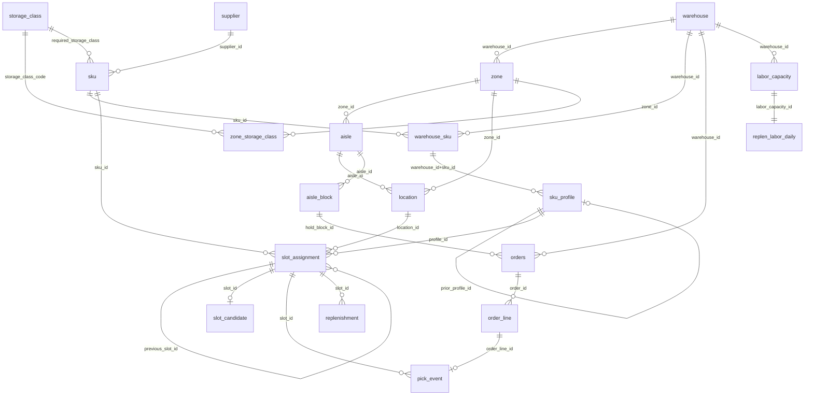

# Entity relationships

Cardinality, optionality and lifecycle. Many-to-many relationships use bridge tables (`zone_storage_class`, `warehouse_sku`, and the time-bounded `slot_assignment` between SKU and Location).

| Parent | Child | FK | Cardinality | Optional |
|---|---|---|---|---|
| warehouse | zone | `warehouse_id` | 1:N | no |
| zone | aisle | `zone_id` | 1:N | no |
| aisle | location | `aisle_id` | 1:N | no |
| zone | location | `zone_id` | 1:N | no |
| zone | zone_storage_class | `zone_id` | 1:N (zone N:M storage_class) | no |
| storage_class | zone_storage_class | `storage_class_code` | 1:N (zone N:M storage_class) | no |
| supplier | sku | `supplier_id` | 1:N | no |
| storage_class | sku | `required_storage_class` | 1:N | no |
| warehouse | warehouse_sku | `warehouse_id` | 1:N (warehouse N:M sku) | no |
| sku | warehouse_sku | `sku_id` | 1:N (warehouse N:M sku) | no |
| warehouse_sku | sku_profile | `warehouse_id+sku_id` | 1:N (one per version) | no |
| sku_profile | sku_profile | `prior_profile_id` | 1:0..1 (version chain) | yes |
| sku | slot_assignment | `sku_id` | 1:N (sku N:M location over time) | no |
| location | slot_assignment | `location_id` | 1:N (<=1 ACTIVE at a time) | no |
| sku_profile | slot_assignment | `profile_id` | 1:0..N | yes |
| slot_assignment | slot_assignment | `previous_slot_id` | 1:0..N (supersession chain) | yes |
| slot_assignment | slot_candidate | `slot_id` | 1:0..1 (selected candidate) | yes |
| warehouse | orders | `warehouse_id` | 1:N | no |
| orders | order_line | `order_id` | 1:N (1..20 lines) | no |
| order_line | pick_event | `order_line_id` | 1:0..1 (cancelled lines have none) | yes |
| slot_assignment | pick_event | `slot_id` | 1:N | no |
| aisle | aisle_block | `aisle_id` | 1:0..N | yes |
| aisle_block | orders | `hold_block_id` | 1:0..N | yes |
| slot_assignment | replenishment | `slot_id` | 1:0..N | yes |
| warehouse | labor_capacity | `warehouse_id` | 1:N (one per day) | no |
| labor_capacity | replen_labor_daily | `labor_capacity_id` | 1:1 | no |

## Lifecycle states and effective dating

| Entity | States | Transitions (logged in `state_event`) | Effective dating |
|---|---|---|---|
| orders | CREATED, RELEASED, ON_HOLD, PICKED, SHIPPED, CANCELLED | CREATED->RELEASED->(ON_HOLD->RELEASED)->PICKED->SHIPPED; CREATED->CANCELLED | order_ts .. shipped_ts |
| slot_assignment | PROPOSED, APPROVED, ACTIVE, SUPERSEDED, REJECTED | legacy: ->ACTIVE->SUPERSEDED; optimizer: ->PROPOSED->ACTIVE; override: ->PROPOSED->APPROVED/REJECTED | effective_from (incl.) .. effective_to (excl., NULL = open) |
| replenishment | CREATED, COMPLETED | CREATED->COMPLETED | created_ts .. completed_ts |
| aisle | ACTIVE, BLOCKED | ACTIVE->BLOCKED->ACTIVE per aisle_block | aisle_block start_ts .. end_ts (excl.) |
| sku_profile | versioned | new version supersedes prior (prior_profile_id) | effective_from .. effective_to |
| warehouse_sku / location | ACTIVE (INACTIVE locations are never slotted) | - | effective_from |
